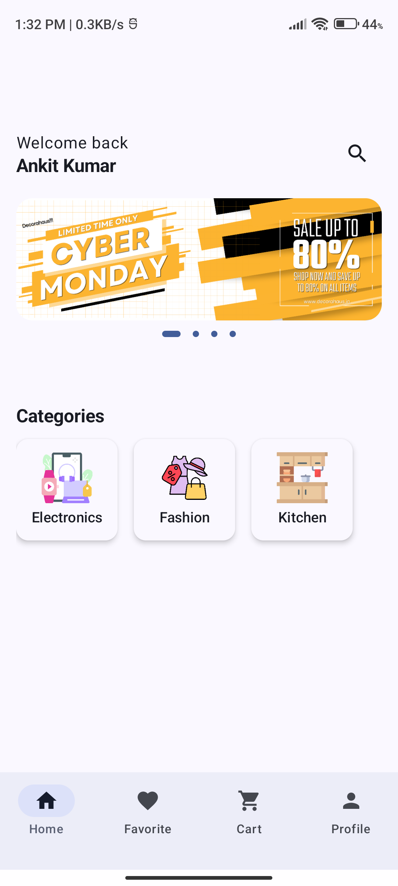
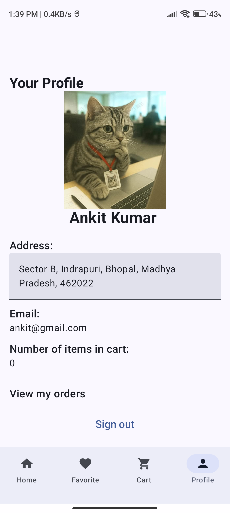

# 🛍️ EasyShop - Modern Android E-Commerce App

EasyShop is a production-grade, feature-rich Android e-commerce application built natively using **Jetpack Compose** and **Firebase**. Designed with modern Android development standards, Material 3 design principles, and reactive state management, it provides a seamless online shopping experience from product discovery to secure checkout.

---

## 📱 App UI Preview

| Home Screen | Cart Page | Profile Page |
| :---: | :---: | :---: |
|  |  |  |

---

## 🚀 Key Features

- **🔐 Secure Authentication**: Firebase Auth-powered Login and Signup flows with persistent session handling.
- **🏠 Dynamic Home Dashboard**: Features promotional banners (`HorizontalPager`), category carousels, and personalized user greetings.
- **📦 Product Catalog & Details**: 
  - Browse products grouped by categories.
  - Immersive product detail pages with image sliders, dots indicators (`viewpagerdotsindicator`), pricing breakdown (strikethrough actual vs. discount price), and detailed descriptions.
- **🛒 Real-Time Cart Management**:
  - Add, increment, decrement, and remove items dynamically.
  - Real-time cart synchronization using Firestore snapshot listeners (`addSnapshotListener`).
  - Atomic cart updates utilizing Firestore `FieldValue.increment` and nested Maps.
- **💳 Payment Integration**: Integrated **Razorpay Checkout SDK** for secure real-world payment processing.
- **👤 User Profile & Orders**: Manage shipping addresses, view account details, and track order history.

---

## 🛠️ Tech Stack & Architecture

- **UI Toolkit**: Jetpack Compose, Material 3, Material Icons Extended
- **Image Loading**: Coil 3 (supporting modern network requests and crossfade)
- **Backend & Database**: Firebase Firestore (NoSQL cloud database)
- **Authentication**: Firebase Authentication
- **Navigation**: Jetpack Navigation Compose (`NavHost`, `NavController`)
- **Payment Gateway**: Razorpay Android SDK (`com.razorpay:checkout`)
- **Language**: Kotlin 2.x

---

## 📁 Project Structure

```tree
com.example.easyshop/
├── components/       # Reusable UI components (BannerView, CategoriesView, CartItemView, ProductDetailsView, etc.)
├── model/            # Data models (ProductModel, UserModel, OrderModel, categoryModel)
├── pages/            # Full-screen pages (HomePage, CartPage, CheckoutPage, ProfilePage, OrdersPage, etc.)
├── screen/           # Top-level navigation screens (HomeScreen, AuthScreen, LoginScreen, SignupScreen)
├── ui/theme/         # Material 3 Theme, Color, and Typography definitions
├── viewmodel/        # ViewModels for handling business logic & auth state
└── AppNavigation.kt  # Centralized Navigation graph
```

---

## ⚙️ Getting Started & Setup

1. **Clone the repository**:
   ```bash
   git clone https://github.com/Ankitkumar747/EasyShop.git
   ```
2. **Open in Android Studio**:
   - Open Android Studio and select *Open an Existing Project*.
3. **Configure Firebase**:
   - Create a project on [Firebase Console](https://console.firebase.google.com/).
   - Enable **Firebase Authentication** (Email/Password) and **Firestore Database**.
   - Download your `google-services.json` file and place it in the `app/` directory (`app/google-services.json`).
4. **Build and Run**:
   - Sync Gradle and run the app on an Android Emulator or physical device (API 26+).

---

## 👨‍💻 Developer

Built with ❤️ by **Ankit Kumar**
- GitHub: [@Ankitkumar747](https://github.com/Ankitkumar747)
